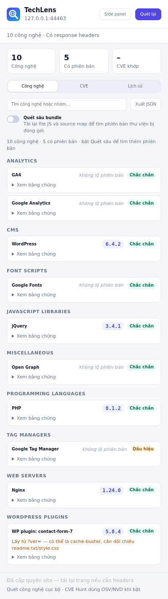
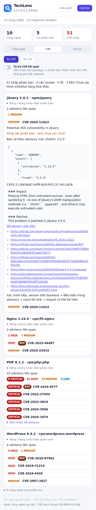

# TechLens

**See what a website is built with — and whether those versions have known vulnerabilities.**

TechLens is a Chrome/Edge extension (plus a command-line scanner) that fingerprints the technologies behind any website and checks the exact versions it finds against public vulnerability databases.

- **Detects 60+ technologies** — frameworks, libraries, CMS, analytics, CDNs, web servers — and shows the evidence for every result.
- **Finds real version numbers**, even in bundled code: matches script files against 2,500+ official library releases, reads license banners and source maps.
- **CVE Hunt** looks up detected versions in [OSV](https://osv.dev) (npm packages) and [NVD](https://nvd.nist.gov) (Nginx, Apache, PHP, WordPress…), and flags vulnerabilities on the CISA _Known Exploited_ list.
- **Privacy first** — scanning happens locally in your browser. CVE lookups send only a package name and version, never the website URL.
- **Side panel and scan history** to keep results while you browse and see what changed between visits.
- **Batch CLI** to scan a list of domains and export JSONL or CSV.

<p align="center">
  
  
</p>

> TechLens reports _indicators_. A matching version does not prove a site is exploitable: the vulnerable code path, configuration or backported patches still need to be verified.

## Install the extension

Requires Chrome or Edge **123 or later**.

1. Download `TechLens-<version>.zip` from the [latest release](https://github.com/Jaycelation/TechLens/releases/latest) and unzip it.
   (Or clone this repository — the extension runs straight from the source folder, no build step.)
2. Open `chrome://extensions` (Chrome) or `edge://extensions` (Edge).
3. Turn on **Developer mode**.
4. Click **Load unpacked** and select the folder that contains `manifest.json`.
5. Pin **TechLens** from the extensions (puzzle) menu.

To update, replace the folder contents and click the reload ↻ button on the TechLens card.

## Use the extension

The interface is currently in Vietnamese; button labels are shown below with their meaning.

### Scan a page

Open any `http://` or `https://` page and click the TechLens icon. Results are grouped by category; open **Xem bằng chứng** (show evidence) on a card to see why it was detected. Use the search box to filter, **Quét lại** (rescan) after the page changes, and **Xuất JSON** (export JSON) to save the report.

### Options

| Option                                 | What it does                                                                                                                                                         |
| -------------------------------------- | -------------------------------------------------------------------------------------------------------------------------------------------------------------------- |
| **Quét sâu bundle** (deep bundle scan) | Re-reads the page's scripts (usually from cache, without cookies) to identify versions by file hash, license banner and source map. Off by default.                  |
| **Cấp quyền site** (grant site access) | Lets TechLens read server headers (e.g. `Server: nginx/1.24.0`) and scan this site from the side panel. Reload the page afterwards.                                  |
| **Mở side panel** (open side panel)    | Keeps results visible while you switch tabs; the panel rescans the active tab automatically.                                                                         |
| **Lưu lịch sử** (save history)         | Keeps your last 50 scans on this device and highlights added, removed and upgraded technologies. Off by default; **Xóa lịch sử** (clear history) removes everything. |

### CVE Hunt

1. After a scan, click **CVE Hunt** and allow access to `api.osv.dev` and `services.nvd.nist.gov` when asked.
2. Each technology with an exact version is checked. Results show the CVE/GHSA ID, severity, CVSS vector, affected and fixed versions, and links to the advisory. **KEV** marks vulnerabilities known to be exploited in the wild.
3. **Tra mới** (refresh) bypasses the 6-hour cache. **Tự hunt khi quét** (auto-hunt on scan) runs CVE Hunt every time you scan.

Technologies without an exact version are listed as _chưa kiểm tra_ (not checked) with the reason. Server versions from Linux distribution packages (for example `Apache/2.4.57 (Debian)`) are marked _cần review_ (needs review), because distributions often backport fixes without changing the version number.

## Command-line scanner

Scan many sites with the same detection engine in headless Chromium. **Only scan targets you are authorised to test.**

Requires Node.js 20+.

```sh
git clone https://github.com/Jaycelation/TechLens.git && cd TechLens
npm install
npx playwright install chromium

node cli/techscan.mjs example.com                        # one site, JSON lines to stdout
node cli/techscan.mjs -i domains.txt --deep --cve -o results.jsonl
node cli/techscan.mjs -i domains.txt -f csv > stack.csv  # one row per technology
```

| Flag                      | Description                                          |
| ------------------------- | ---------------------------------------------------- |
| `-i, --input <file>`      | Targets from a file, one per line (`#` for comments) |
| `-o, --output <file>`     | Write to a file instead of stdout                    |
| `-f, --format jsonl\|csv` | Output format (default `jsonl`)                      |
| `-c, --concurrency <n>`   | Pages scanned in parallel (default 4)                |
| `--deep`                  | Deep bundle scan (hashes, banners, source maps)      |
| `--cve`                   | Look up CVEs via OSV and NVD                         |
| `--timeout <ms>`          | Page load timeout (default 30000)                    |

Targets without a scheme are treated as `https://`. Sites that fail to load are reported as error rows without stopping the run.

## Privacy

- Page scanning runs entirely in your browser; no TechLens server exists.
- CVE Hunt sends OSV a package name and version, and NVD a product identifier (CPE). Website URLs, page content and cookies are never sent.
- Only a short list of technology headers is kept, in session memory, and cleared when the tab closes.
- History is opt-in, stored locally, and contains only site origins, technology names and versions.

## Contributing

See [CONTRIBUTING.md](CONTRIBUTING.md) for adding fingerprints, running tests and the project layout.

## License

[MIT](LICENSE)
